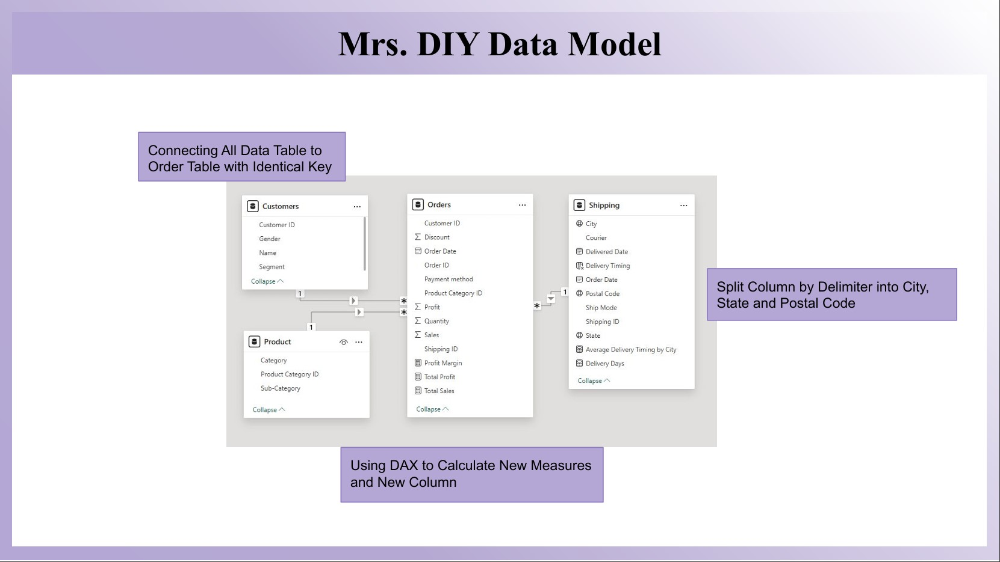
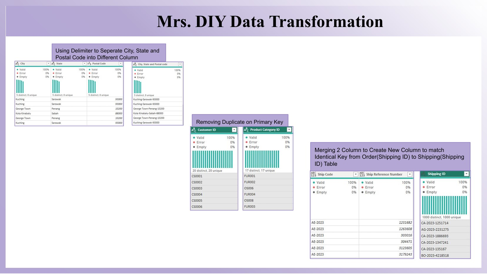
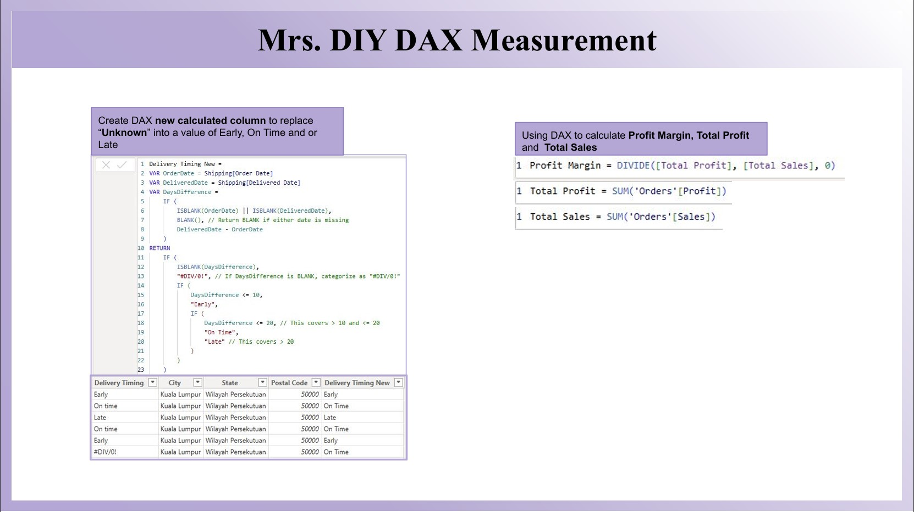
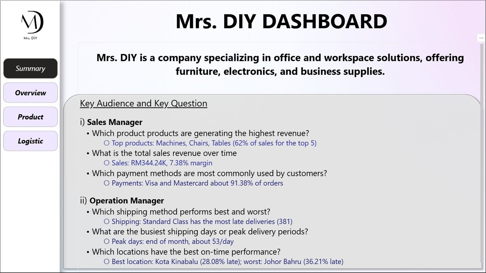
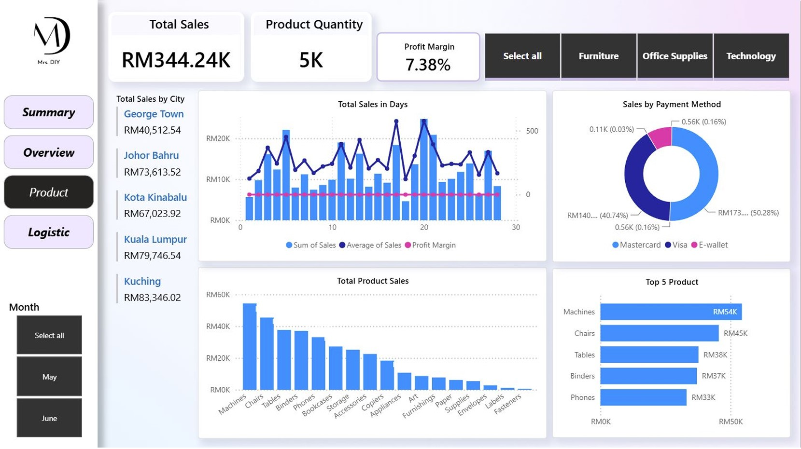
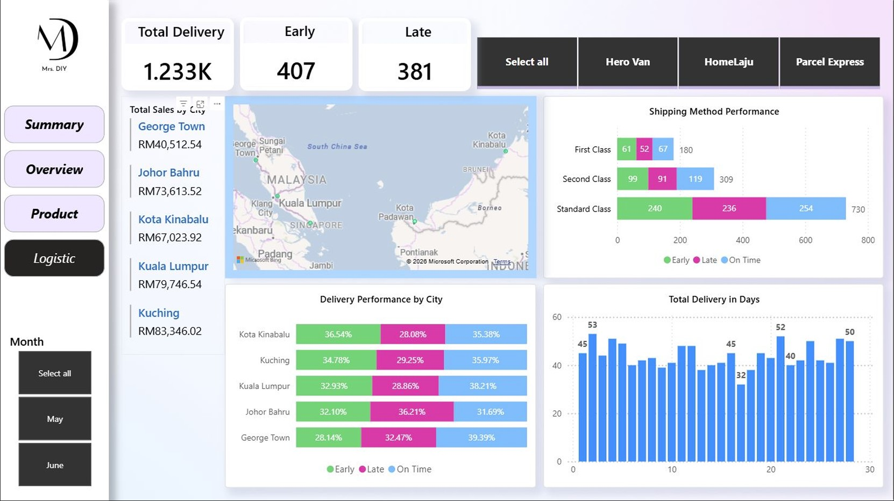

# Mrs. DIY Sales & Logistics Dashboard (Power BI)

> Portfolio project using a **sample/training dataset** (not real company
> data). Currency: Malaysian Ringgit (RM). Period: May-June.

## Business Questions
**Sales Manager**
- Which products generate the highest revenue?
- What is the total sales revenue over time?
- Which payment methods are most commonly used?

**Operations Manager**
- Which shipping method performs best and worst?
- What are the busiest shipping days or peak delivery periods?
- Which locations have the best on-time performance?

## Tools
Power BI, Power Query, DAX, Excel

## Data Model
Star schema with **Orders** as the central table, linked one-to-many to
**Customers**, **Product** and **Shipping** using shared keys.

## Data Transformation (Power Query)
- Split "City, State and Postal Code" into separate columns
- Removed duplicates on primary keys (Customer ID, Product Category ID,
  Shipping ID)
- Merged Ship Code + Ship Reference Number to create a Shipping ID that
  matches the Orders table

## DAX
- `Total Sales = SUM('Orders'[Sales])`
- `Total Profit = SUM('Orders'[Profit])`
- `Profit Margin = DIVIDE([Total Profit], [Total Sales], 0)`
- Calculated column `Delivery Timing New`: Early (<=10 days),
  On Time (11-20 days), Late (>20 days). Thresholds are my own assumption.

## Key Findings
| Question | Answer |
|---|---|
| Top products | Machines, Chairs and Tables lead sales |
| Total sales | RM344.24K at a 7.38% profit margin |
| Payment methods | Visa and Mastercard make up 91.38% of orders |
| Shipping performance | Standard Class has the most late deliveries (381) |
| Peak delivery days | End of month, about 53 deliveries per day |
| Delivery by location | Kota Kinabalu performs best; Johor Bahru is worst (36.21% late) |

## Recommendations
1. Review Standard Class courier performance, since it has the most late
   deliveries.
2. Investigate causes of delays in Johor Bahru.
3. Plan extra delivery capacity for the end of each month.
4. [Add your own, such as encouraging e-wallet payments.]

## Dashboard

## What I Learned

**Data Transformation (Power Query)**
- Used **Split Column by Delimiter** to separate a combined "City, State and
  Postal Code" field into three columns, so the data could be filtered and
  grouped by location.
- Used **Remove Duplicates** on primary key columns (Customer ID, Product
  Category ID) so each table has unique keys, which is required for a
  one-to-many relationship.
- **Merged two columns** (Ship Code and Ship Reference Number) to create a new
  Shipping ID that matches the key in the Orders table.
- Used **Column quality and Column distribution** to check for errors, empty
  values and duplicate keys before loading the data.

**Data Modelling**
- Connected the Customers, Product and Shipping tables to the Orders table
  using shared keys, forming a star schema.
- Learned why clean, unique keys matter: a duplicate key on the "one" side
  of a relationship breaks the model.

**DAX Measures and Calculated Column**
- Wrote basic measures: **Total Sales** and **Total Profit** using SUM, and
  **Profit Margin** using DIVIDE, which avoids divide-by-zero errors.
- Created a calculated column using **variables (VAR), IF and ISBLANK** to
  classify each delivery as Early, On Time or Late based on the difference
  between order date and delivered date, and to handle missing dates.
- Learned the difference between a **measure** (calculated at query time and
  responds to filters) and a **calculated column** (calculated per row).

**Dashboard Design**
- Structured the report around two audiences (Sales Manager and Operations
  Manager) and the questions each one needs answered.
- Added slicers (month, product category, courier) and navigation buttons
  to make the report interactive.

## Contact
[Danial Bin Azmy] | [www.linkedin.com/in/danial-azmy] | [Danial3034@gmail.com]
